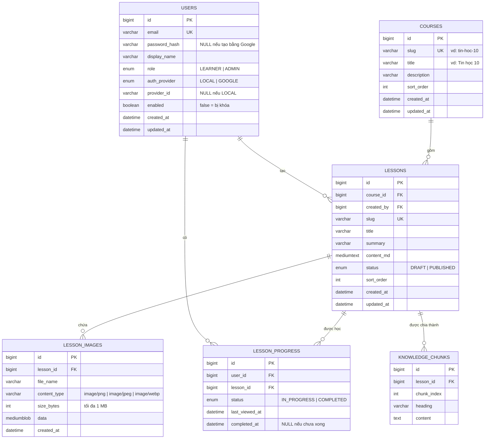

# Thiết kế cơ sở dữ liệu Space-X

Trạng thái: **thiết kế, chưa có migration** (cập nhật 2026-10-21). Schema thật sẽ tạo bằng Flyway; khi viết hoặc sửa migration phải cập nhật file này trong cùng nhánh.
Hệ quản trị: MySQL 8.4, `utf8mb4`, collation `utf8mb4_0900_ai_ci` (so sánh không phân biệt hoa/thường và dấu).

## 1. Sơ đồ ERD

Bảng lưu session (nếu dùng Spring Session JDBC) và bảng lịch sử migration của Flyway do framework tự tạo, không vẽ trong ERD.

## 2. Mô tả bảng

| Bảng | Vai trò | Ràng buộc chính |
|---|---|---|
| `users` | Tài khoản học sinh và quản trị | `email` duy nhất; mật khẩu băm BCrypt, không bao giờ lưu rõ; `password_hash` NULL với tài khoản tạo bằng Google; `enabled = false` là bị khóa |
| `courses` | Khóa học: Tin học 10, 11, 12 | `slug` duy nhất để dùng trong URL |
| `lessons` | Bài học viết bằng Markdown | Thuộc đúng một khóa; `created_by` là Admin tạo bài; chỉ bài `PUBLISHED` hiện với học sinh và được đưa vào chỉ mục tìm kiếm |
| `lesson_images` | Ảnh chèn trong bài | Thuộc đúng một bài; chỉ PNG/JPEG/WebP, tối đa 1 MB (kiểm ở backend bằng nội dung file, không chỉ dựa vào đuôi) |
| `lesson_progress` | Tiến độ của một học sinh với một bài | Cặp `(user_id, lesson_id)` duy nhất: mỗi học sinh có đúng một dòng cho mỗi bài |
| `knowledge_chunks` | Các đoạn nhỏ cắt từ bài, dùng cho chatbot | `(lesson_id, chunk_index)` duy nhất; chỉ mục `FULLTEXT(heading, content)`; là dữ liệu **dẫn xuất**, luôn dựng lại được từ `lessons` |

## 3. Quan hệ và quy tắc xóa

| Quan hệ | Kiểu | Khi xóa bản ghi cha |
|---|---|---|
| `courses` → `lessons` | 1–N | `RESTRICT`: không xóa khóa còn bài (API trả 409) |
| `users` → `lessons` (`created_by`) | 1–N | Không xóa người dùng, chỉ khóa tài khoản |
| `lessons` → `lesson_images` | 1–N | `CASCADE`: xóa bài thì xóa ảnh |
| `lessons` → `lesson_progress` | 1–N | `CASCADE` |
| `users` → `lesson_progress` | 1–N | Không xóa người dùng |
| `lessons` → `knowledge_chunks` | 1–N | `CASCADE` |

- `users` và `lessons` có quan hệ **nhiều–nhiều** (một học sinh học nhiều bài, một bài được nhiều học sinh học). `lesson_progress` là bảng trung gian tách nó thành hai quan hệ 1–N và mang thêm dữ liệu riêng (trạng thái, thời điểm).
- **Không xóa người dùng** vì sẽ mất tác giả của bài học và lịch sử học. Khóa tài khoản là đủ và hoàn tác được.

## 4. Chỉ mục

| Bảng | Chỉ mục | Mục đích |
|---|---|---|
| `users` | `UNIQUE(email)`, `UNIQUE(auth_provider, provider_id)` | Đăng nhập, chống trùng tài khoản. MySQL cho phép nhiều dòng NULL trong chỉ mục UNIQUE nên tài khoản `LOCAL` (provider_id NULL) không xung đột |
| `courses` | `UNIQUE(slug)` | Tra theo URL |
| `lessons` | `UNIQUE(slug)`, `(course_id, status, sort_order)` | Danh sách bài theo khóa |
| `lesson_progress` | `UNIQUE(user_id, lesson_id)` | Chống trùng; cột đầu là `user_id` nên cũng dùng được khi lấy tiến độ của một học sinh |
| `knowledge_chunks` | `UNIQUE(lesson_id, chunk_index)`, `FULLTEXT(heading, content)` | Dựng lại đoạn, tìm kiếm |

## 5. Quy tắc nghiệp vụ gắn với dữ liệu

**Tiến độ học tập**
- Mở một bài: chưa có dòng thì tạo `IN_PROGRESS`; đã có thì cập nhật `last_viewed_at`. Bài đã `COMPLETED` **không bị hạ** về `IN_PROGRESS` khi mở lại.
- Bấm "Hoàn thành bài": `status = COMPLETED`, ghi `completed_at`.
- % của một khóa = số bài `COMPLETED` đang ở trạng thái `PUBLISHED` / tổng số bài `PUBLISHED` của khóa. Admin ẩn một bài thì % tự tính lại.
- "Học tiếp": bài `IN_PROGRESS` có `last_viewed_at` mới nhất; nếu không có thì bài `PUBLISHED` đầu tiên (theo `sort_order`) chưa `COMPLETED`.
- "Học lại khóa": xóa các dòng `lesson_progress` của học sinh đó thuộc các bài trong khóa.

**Ảnh bài học**
- Chèn vào bài bằng Markdown: ``. Ai xem được bài thì xem được ảnh của bài đó.
- Chatbot chỉ đọc chữ, nên phần mô tả ảnh trong ngoặc vuông phải viết rõ nghĩa.

**Tài khoản**
- Đăng nhập Google: chỉ chấp nhận email Google báo đã xác minh. Đã có tài khoản cùng email thì đăng nhập vào tài khoản đó; chưa có thì tạo mới với `auth_provider = GOOGLE`, `role = LEARNER`, `password_hash = NULL`.
- Đổi mật khẩu chỉ áp dụng cho tài khoản có mật khẩu.
- Tài khoản bị khóa không đăng nhập được, kể cả qua Google. Admin không tự khóa chính mình và không khóa được Admin cuối cùng.
- Admin đầu tiên được tạo khi ứng dụng khởi động, từ biến môi trường `ADMIN_EMAIL` và `ADMIN_PASSWORD`, chỉ khi chưa có Admin nào.

## 6. Chia đoạn (chunking) và trích dẫn

1. Khi một bài được đăng hoặc sửa, trong **một transaction**: xóa các đoạn cũ của bài đó rồi tạo đoạn mới.
2. Cắt theo tiêu đề Markdown cấp 2 (`##`). Mục nào quá dài (khoảng trên 1500 ký tự) thì cắt tiếp theo đoạn văn.
3. Mỗi đoạn lưu `heading` (tiêu đề mục) để hiển thị và liên kết.
4. **Trích dẫn** gồm: tiêu đề bài, slug của bài, `heading` và `knowledge_chunks.id`, để người dùng mở đúng bài và đúng mục.
5. Bài chuyển về `DRAFT` hoặc bị xóa thì các đoạn tương ứng biến mất khỏi chỉ mục.

## 7. Quyết định để lại cho các tuần sau

| Vấn đề | Lựa chọn | Chốt ở |
|---|---|---|
| Lưu session ở đâu | (a) bộ nhớ: mất hết khi Render cho ứng dụng ngủ, người dùng bị đăng xuất; (b) Spring Session JDBC lưu vào MySQL. **Nghiêng về (b)** | Tuần 4 |
| Nội dung Markdown có chứa HTML không | Không cho HTML thô để tránh XSS; frontend chỉ render Markdown đã lọc | Tuần 5 |
| Dung lượng | Aiven free có 1 GB đĩa; ảnh giới hạn 1 MB mỗi ảnh, theo dõi tổng dung lượng | Tuần 5 |
