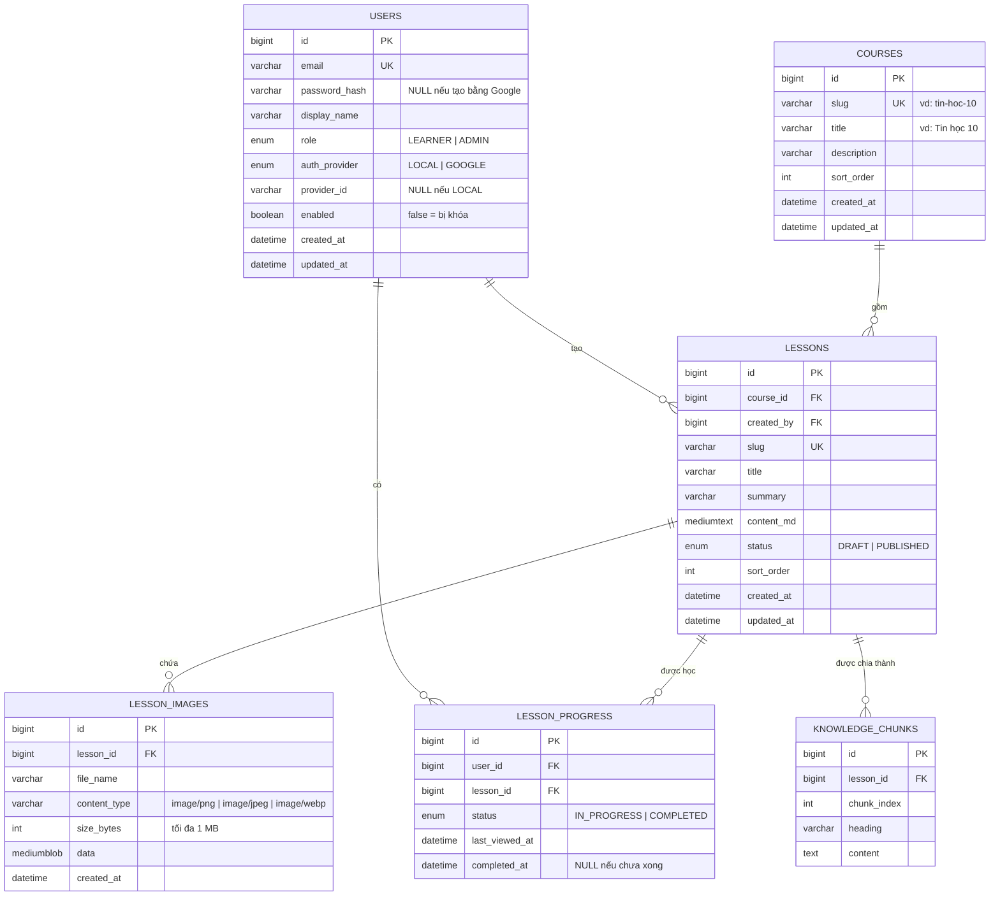
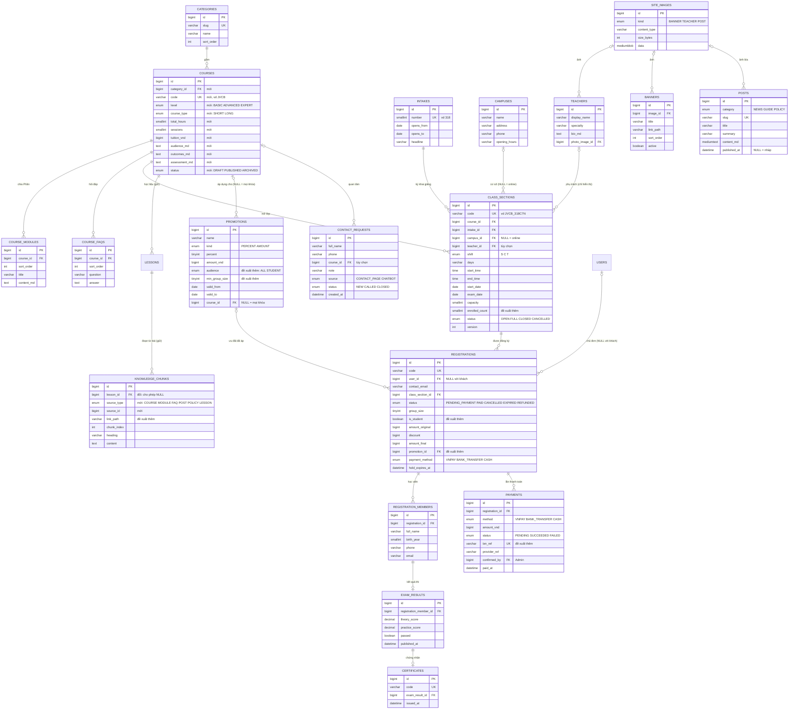
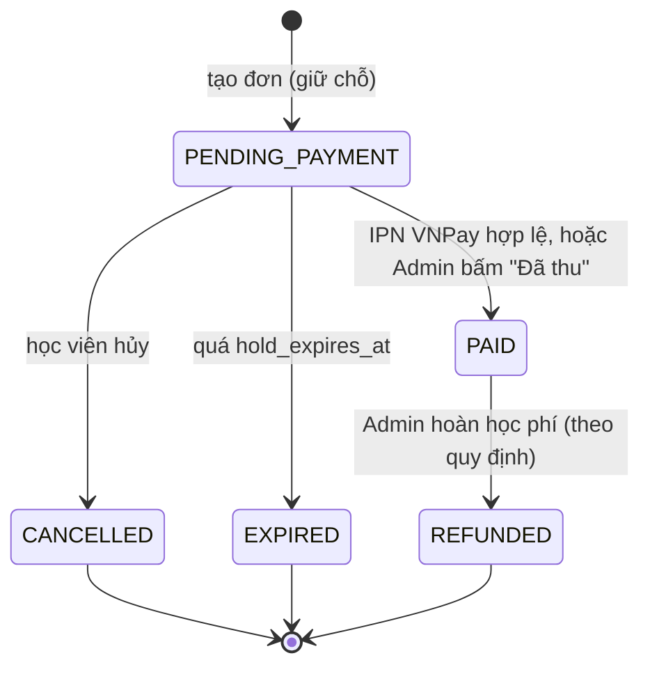

# Thiết kế cơ sở dữ liệu Space-X

Trạng thái (cập nhật 2026-11-20): **đã có 5 migration** (`V5__create_course_covers.sql` tạo bảng `course_covers` cho ảnh bìa khóa học, D35; mô tả ở bảng bên dưới). Trước đó (2026-11-19): **đã có 4 migration** (`V4__add_lesson_image_cover.sql` thêm cột `lesson_images.is_cover`, D33; phần mô tả bên dưới viết đến `V3`). Trước đó (2026-11-15): **đã có 3 migration** — `V1__create_tables.sql` (6 bảng), `V2__create_spring_session_tables.sql` (bảng session) và `V3__add_lessons_fulltext_index.sql` (chỉ mục FULLTEXT cho `lessons`) — đã kiểm trên MySQL 8.4 bằng Testcontainers. `V1` chạy trên Aiven từ 2026-10-31; ứng dụng trên Render khởi động được và tìm kiếm FULLTEXT chạy đúng trên production ngày 2026-11-13 nên `V2`, `V3` cũng đã áp dụng ở đó. Schema thật tạo bằng Flyway; khi viết hoặc sửa migration phải cập nhật file này trong cùng nhánh.
Hệ quản trị: MySQL 8.4, `utf8mb4`, collation `utf8mb4_0900_ai_ci` (so sánh không phân biệt hoa/thường và dấu).

## 1. Sơ đồ ERD

Bảng lưu session (Spring Session JDBC, từ việc 3.6) và bảng lịch sử migration của Flyway do framework tự tạo, không vẽ trong ERD.

## 2. Mô tả bảng

| Bảng | Vai trò | Ràng buộc chính |
|---|---|---|
| `users` | Tài khoản học sinh và quản trị | `email` duy nhất; mật khẩu băm BCrypt, không bao giờ lưu rõ; `password_hash` NULL với tài khoản tạo bằng Google; `enabled = false` là bị khóa |
| `courses` | Khóa học: Tin học 10, 11, 12 | `slug` duy nhất để dùng trong URL |
| `course_covers` | Ảnh bìa khóa học (`V5`, D35), tách bảng để danh sách khóa không tải dữ liệu ảnh | Khóa chính chính là `course_id` nên mỗi khóa tối đa một ảnh do database giữ (đặt ảnh mới là ghi đè dòng cũ); cột `content_type`, `size_bytes`, `data` (`MEDIUMBLOB`), `updated_at` (dùng làm mốc `?v=` trong đường dẫn ảnh); chỉ PNG/JPEG/WebP, tối đa 1 MB (kiểm bằng nội dung file như ảnh bài học). Khác ảnh bài học: ảnh bìa khóa **công khai** vì trang chủ hiện cho khách |
| `lessons` | Bài học viết bằng Markdown | Thuộc đúng một khóa; `created_by` là Admin tạo bài; chỉ bài `PUBLISHED` hiện với học sinh và được đưa vào chỉ mục tìm kiếm |
| `lesson_images` | Ảnh chèn trong bài; cột `is_cover` (`V4`, D33) đánh dấu ảnh bìa | Thuộc đúng một bài; mỗi bài tối đa một ảnh `is_cover = 1` (do `ImageService` giữ, không có ràng buộc UNIQUE); chỉ PNG/JPEG/WebP, tối đa 1 MB (kiểm ở backend bằng nội dung file, không chỉ dựa vào đuôi) |
| `lesson_progress` | Tiến độ của một học sinh với một bài | Cặp `(user_id, lesson_id)` duy nhất: mỗi học sinh có đúng một dòng cho mỗi bài |
| `knowledge_chunks` | Các đoạn nhỏ cắt từ bài, dùng cho chatbot | `(lesson_id, chunk_index)` duy nhất; chỉ mục `FULLTEXT(heading, content)`; là dữ liệu **dẫn xuất**, luôn dựng lại được từ `lessons` |

## 3. Quan hệ và quy tắc xóa

| Quan hệ | Kiểu | Khi xóa bản ghi cha |
|---|---|---|
| `courses` → `lessons` | 1–N | `RESTRICT`: không xóa khóa còn bài (API trả 409) |
| `courses` → `course_covers` | 1–1 | `CASCADE`: xóa khóa thì xóa ảnh bìa |
| `users` → `lessons` (`created_by`) | 1–N | Không xóa người dùng, chỉ khóa tài khoản |
| `lessons` → `lesson_images` | 1–N | `CASCADE`: xóa bài thì xóa ảnh |
| `lessons` → `lesson_progress` | 1–N | `CASCADE` |
| `users` → `lesson_progress` | 1–N | Không xóa người dùng |
| `lessons` → `knowledge_chunks` | 1–N | `CASCADE` |

- `users` và `lessons` có quan hệ **nhiều–nhiều** (một học sinh học nhiều bài, một bài được nhiều học sinh học). `lesson_progress` là bảng trung gian tách nó thành hai quan hệ 1–N và mang thêm dữ liệu riêng (trạng thái, thời điểm).
- **Không xóa người dùng** vì sẽ mất tác giả của bài học và lịch sử học. Khóa tài khoản là đủ và hoàn tác được.

## 4. Chỉ mục

| Bảng | Chỉ mục | Mục đích |
|---|---|---|
| `users` | `UNIQUE(email)`, `UNIQUE(auth_provider, provider_id)` | Đăng nhập, chống trùng tài khoản. MySQL cho phép nhiều dòng NULL trong chỉ mục UNIQUE nên tài khoản `LOCAL` (provider_id NULL) không xung đột |
| `courses` | `UNIQUE(slug)` | Tra theo URL |
| `lessons` | `UNIQUE(slug)`, `(course_id, status, sort_order)`, `FULLTEXT ft_lessons_title_summary_content (title, summary, content_md)` (`V3`) | Danh sách bài theo khóa; tìm bài `GET /api/lessons?q=` (D29). Độ liên quan tính chung cho cả ba cột |
| `lesson_progress` | `UNIQUE(user_id, lesson_id)` | Chống trùng; cột đầu là `user_id` nên cũng dùng được khi lấy tiến độ của một học sinh |
| `knowledge_chunks` | `UNIQUE(lesson_id, chunk_index)`, `FULLTEXT(heading, content)` | Dựng lại đoạn, tìm kiếm |

## 5. Quy tắc nghiệp vụ gắn với dữ liệu

**Tiến độ học tập**
- Mở một bài: chưa có dòng thì tạo `IN_PROGRESS`; đã có thì cập nhật `last_viewed_at`. Bài đã `COMPLETED` **không bị hạ** về `IN_PROGRESS` khi mở lại.
- Bấm "Hoàn thành bài": `status = COMPLETED`, ghi `completed_at`.
- % của một khóa = số bài `COMPLETED` đang ở trạng thái `PUBLISHED` / tổng số bài `PUBLISHED` của khóa. Admin ẩn một bài thì % tự tính lại.
- "Học tiếp": bài `IN_PROGRESS` có `last_viewed_at` mới nhất; nếu không có thì bài `PUBLISHED` đầu tiên (theo `sort_order`) chưa `COMPLETED`.
- "Học lại khóa": xóa các dòng `lesson_progress` của học sinh đó thuộc các bài trong khóa.

**Ảnh bài học**
- Chèn vào bài bằng Markdown: ``. Ai xem được bài thì xem được ảnh của bài đó.
- Chatbot chỉ đọc chữ, nên phần mô tả ảnh trong ngoặc vuông phải viết rõ nghĩa.

**Tài khoản**
- Đăng nhập Google: chỉ chấp nhận email Google báo đã xác minh. **Không tự liên kết** với tài khoản mật khẩu (D25). Tài khoản được tra theo `provider_id` = mã `sub` của Google (không theo email, vì email có thể đổi). Chưa có thì tạo mới với `auth_provider = GOOGLE`, `role = LEARNER`, `password_hash = NULL`, `provider_id = sub`; đã có thì đăng nhập vào tài khoản đó. Email đã thuộc tài khoản `LOCAL` thì không đăng nhập và không tạo thêm được (cột `email` là `UNIQUE`): chuyển về `/dang-nhap?loi=google-email-mat-khau` (D31).
- Đổi mật khẩu chỉ áp dụng cho tài khoản có mật khẩu.
- Tài khoản bị khóa không đăng nhập được, kể cả qua Google. Đăng nhập bằng email trả `401` chung, không báo "bị khóa" (D25). Admin không tự khóa chính mình và không khóa được Admin cuối cùng.
- Admin đầu tiên được tạo khi ứng dụng khởi động, từ biến môi trường `ADMIN_EMAIL` và `ADMIN_PASSWORD`, chỉ khi chưa có Admin nào.
- Hai bảng `SPRING_SESSION` và `SPRING_SESSION_ATTRIBUTES` (migration `V2`) do Spring Session quản lý, lưu phiên đăng nhập; không thuộc ERD 6 bảng của ứng dụng và không có khóa ngoại tới `users`. `PRINCIPAL_NAME` là email, nới lên 255 ký tự cho khớp `users.email`. Tên bảng viết hoa vì thư viện truy vấn đúng tên này.
- Đăng ký bằng email (D25): `auth_provider = LOCAL`, `provider_id = NULL`, `role = LEARNER`, `enabled = TRUE`. `password_hash` lưu chuỗi BCrypt (60 ký tự, vừa cột `VARCHAR(255)`). `confirmPassword` không có cột nào.
- Email được cắt khoảng trắng đầu/cuối và chuyển chữ thường (`Locale.ROOT`) trước khi lưu và trước mọi truy vấn theo email. Việc này làm trong ứng dụng, không dựa riêng vào collation `_ai_ci`.
- Giới hạn cột: `email` 255 ký tự, `display_name` 100 ký tự (cắt khoảng trắng, không rỗng). Backend phải kiểm tra trước khi lưu để không gặp lỗi tràn cột của MySQL.
- Mật khẩu: tối thiểu 8 ký tự, tối đa 72 byte UTF-8, **không cắt khoảng trắng**. Phải đếm **byte**, không đếm ký tự, vì BCrypt chỉ dùng 72 byte đầu và ký tự tiếng Việt có dấu chiếm nhiều byte.
- Tài khoản `GOOGLE` có `password_hash = NULL`: đăng nhập bằng mật khẩu nhận cùng lỗi `401` chung như sai mật khẩu. Email đã thuộc tài khoản Google thì đăng ký bằng email trả `409` (cột `email` là `UNIQUE` cho mọi `auth_provider`).

## 6. Chia đoạn (chunking) và trích dẫn

1. Khi một bài được đăng hoặc sửa, trong **một transaction**: xóa các đoạn cũ của bài đó rồi tạo đoạn mới.
2. Cắt theo tiêu đề Markdown cấp 2 (`##`). Mục nào quá dài (khoảng trên 1500 ký tự) thì cắt tiếp theo đoạn văn.
3. Mỗi đoạn lưu `heading` (tiêu đề mục) để hiển thị và liên kết.
4. **Trích dẫn** gồm: tiêu đề bài, slug của bài, `heading` và `knowledge_chunks.id`, để người dùng mở đúng bài và đúng mục.
5. Bài chuyển về `DRAFT` hoặc bị xóa thì các đoạn tương ứng biến mất khỏi chỉ mục.

## 6b. Ghi chú về migration V1

- Thời gian dùng `DATETIME(6)` (độ chính xác micro giây); `updated_at` tự cập nhật bằng `ON UPDATE`.
- Mỗi bảng đặt rõ `utf8mb4` + `utf8mb4_0900_ai_ci`, không phụ thuộc cấu hình mặc định của máy chủ (Aiven, Docker, CI cùng một kết quả).
- `users.email` so sánh không phân biệt hoa/thường nhờ collation `_ai_ci`: `A@x.com` và `a@x.com` là một.
- `knowledge_chunks.heading` là `NOT NULL`: đoạn không có tiêu đề mục (phần mở đầu bài) sẽ dùng tiêu đề bài khi chia đoạn ở Tuần 7.
- Số lượng ảnh, loại ảnh, dung lượng 1 MB chưa có ràng buộc ở database (kiểm ở backend theo nội dung file, như đã thiết kế).

## 6c. Ghi chú về migration V2 và V3

- `V2` tạo `SPRING_SESSION` và `SPRING_SESSION_ATTRIBUTES` cho Spring Session JDBC (xem mục 5, phần Tài khoản).
- `V3` (D29) thêm chỉ mục FULLTEXT cho `lessons`. Thêm chỉ mục lên bảng đã có dữ liệu khiến InnoDB dựng lại bảng (Flyway cảnh báo "rebuilding table to add column FTS_DOC_ID"); bình thường với bảng nhỏ, cần để ý nếu bảng lớn. InnoDB bỏ qua từ ngắn hơn 3 ký tự và từ trong danh sách stopword tiếng Anh; collation `_ai_ci` làm các từ chỉ khác dấu thành một từ.
- Bảng `lesson_progress` (tiến độ học) và cột `users.enabled` (khóa tài khoản) đã có từ `V1`, nên CP5.5 và CP5.6 không cần migration mới.

## 7. Quyết định để lại cho các tuần sau

| Vấn đề | Lựa chọn | Chốt ở |
|---|---|---|
| Lưu session ở đâu | (a) bộ nhớ: mất hết khi Render cho ứng dụng ngủ, người dùng bị đăng xuất; (b) Spring Session JDBC lưu vào MySQL. **Chọn (b)**: ở việc 3.4 dùng session trong bộ nhớ (chấp nhận mất session khi khởi động lại), chuyển sang Spring Session JDBC ở việc 3.6 cùng migration `V2` tạo bảng session (D24, D25) | Chốt (việc 3.6) |
| Nội dung Markdown có chứa HTML không | Không cho HTML thô để tránh XSS; frontend chỉ render Markdown đã lọc | Chốt (CP5.2: `react-markdown` không bật HTML thô, chỉ cho ảnh `/api/images/{id}`; `MarkdownContent.test.tsx` 12 test) |
| Dung lượng | Aiven free có 1 GB đĩa; ảnh giới hạn 1 MB mỗi ảnh, theo dõi tổng dung lượng | Tuần 4 |

## 7b. Migration `V7`: tự học trực tuyến và quyền đọc (D40)

File `V7__add_access_rules.sql` (`Tested` 2026-11-27, chưa deploy).

| Thay đổi | Chi tiết |
|---|---|
| `courses.access_type` | `ENUM('FREE','PAID') NOT NULL DEFAULT 'PAID'`. Mặc định `PAID` để quên đặt thì khóa bị đóng. Khóa đang có bài lúc migrate được đổi sang `FREE` |
| `lessons.module_id` | `BIGINT NULL`, khóa ngoại tới `course_modules` (`ON DELETE SET NULL`). Chưa có giao diện hay API; database chưa kiểm module và bài cùng một khóa |
| Bảng `enrollments` | `user_id`, `course_id`, `status` (`ACTIVE`, `REVOKED`), `source` (`FREE`, `ORDER`, `ADMIN`, `MIGRATION`), `granted_by`, `created_at`, `updated_at` |
| Ràng buộc | `UNIQUE(user_id, course_id)`; `CHECK`: `source = 'ADMIN'` thì phải có `granted_by`; ba khóa ngoại đều chặn xóa (người dùng, khóa, người cấp) |
| Bù quyền | Mỗi cặp người dùng và khóa đã có `lesson_progress` được một dòng `ACTIVE`, `source = 'MIGRATION'` |

Quy tắc quyền đọc dùng bảng này được mô tả ở `docs/API.md`, mục "Quyền đọc bài".

## 8. Bản nháp 2.0 (chưa áp dụng)

**Trạng thái (2026-11-27): phần của `V6` đã được duyệt, cài đặt (`V6__create_course_catalog.sql`), gộp qua PR #56 và deploy; từ đây không sửa file đó nữa. Các bản nháp `V7`–`V10` trong mục này **đã bỏ** (D40); `V7` thật được mô tả ở mục 7b. Phần 1–7 ở trên mô tả schema `V1`–`V5`; những gì `V6` thêm nằm ở mục 8. Đây là thiết kế cho đề tài Trung tâm Tin học SPACE-X (D38): bán khóa học, lịch khai giảng, đăng ký và thanh toán học phí, tra cứu điểm và chứng nhận, chatbot tư vấn. Nguồn: `docs/SPACE-X-2.0.md` mục 5 và 6.

Nguyên tắc: không sửa `V1`–`V5` (Flyway kiểm checksum, `V1` đã chạy trên Aiven); mọi thay đổi đi qua `V6` trở đi, mỗi migration một nhóm việc và chỉ viết khi tới tuần làm nhóm đó; tiền là `BIGINT` (đồng, không có phần lẻ); mọi bảng dùng `utf8mb4` + `utf8mb4_0900_ai_ci`, `DATETIME(6)`, `ENGINE = InnoDB` như `V1`. Các bảng, cột và ràng buộc đánh dấu **(đề xuất thêm)** không có trong đặc tả mục 5, do thiết kế này thêm vào vì một yêu cầu khác của đặc tả cần đến; cần được duyệt riêng.

### 8.1 Sơ đồ ERD (phần mới và phần đổi)

Bảng cũ chỉ vẽ khi có quan hệ tới bảng mới (`USERS`, `COURSES`, `LESSONS`, `KNOWLEDGE_CHUNKS`). Mỗi bảng chỉ liệt kê cột chính; đầy đủ ở mục 8.2.

Không vẽ: `course_covers` (giữ nguyên, `V5`), `lesson_images`, `lesson_progress`, bảng session.

### 8.2 Mô tả bảng mới và cột mới

**Bảng mới** (cột `id BIGINT AUTO_INCREMENT`, `created_at`, `updated_at` như `V1`, không nhắc lại):

| Bảng | Vai trò | Cột và ràng buộc chính |
|---|---|---|
| `categories` | Nhóm chương trình (menu theo nhóm) | `slug VARCHAR(100)` UNIQUE, `name VARCHAR(150)`, `sort_order INT` |
| `course_modules` | Phần của nội dung khóa (bấm để mở từng phần) | `course_id` FK `CASCADE`, `sort_order`, `title VARCHAR(200)`, `content_md TEXT NOT NULL`; chỉ mục `(course_id, sort_order)` |
| `course_faqs` | Hỏi đáp của khóa | `course_id` FK `CASCADE`, `sort_order`, `question VARCHAR(300)`, `answer TEXT` |
| `campuses` | Cơ sở học | `name`, `address VARCHAR(255)`, `phone VARCHAR(20)`, `opening_hours VARCHAR(255)` |
| `intakes` | Kỳ khai giảng tổng | `number SMALLINT` UNIQUE (vd 318), `opens_from DATE`, `opens_to DATE`, `headline VARCHAR(200)`; `CHECK (opens_from <= opens_to)` |
| `teachers` | Đội ngũ giáo viên, **chỉ hiển thị**, không phải vai trò đăng nhập | `display_name VARCHAR(100)`, `specialty VARCHAR(150)`, `bio_md TEXT`, `photo_image_id` FK `SET NULL`, `sort_order` |
| `class_sections` | **Lớp** cụ thể của một khóa trong một kỳ | `code VARCHAR(30)` UNIQUE (sinh tự động `<mã môn>_<kỳ><ca><ngày học>`, thêm `O` nếu online); `course_id`, `intake_id` FK `RESTRICT`; `campus_id` FK `RESTRICT` NULL = online; `teacher_id` FK `SET NULL`; `shift ENUM('S','C','T')` **(đề xuất thêm: để lọc "ca học" của `findUpcomingClasses` và sinh mã, không phải đoán từ giờ)**; `days VARCHAR(30)` (vd `T7,CN`); `start_time`, `end_time TIME`; `start_date`, `exam_date DATE`; `capacity SMALLINT UNSIGNED`; **`enrolled_count SMALLINT UNSIGNED NOT NULL DEFAULT 0` (đề xuất thêm: số chỗ đã giữ hoặc đã bán, giữ dưới khóa dòng)**; `status ENUM('OPEN','FULL','CLOSED','CANCELLED')`; `version INT NOT NULL DEFAULT 0` (cho `@Version` khi Admin sửa lớp cùng lúc) |
| `promotions` | Ưu đãi học phí | `name`; `kind ENUM('PERCENT','AMOUNT')`; `percent TINYINT UNSIGNED` hoặc `amount_vnd BIGINT` (đúng một trong hai theo `kind`); `valid_from`, `valid_to DATE`; `course_id` FK `CASCADE` NULL = mọi khóa; **(đề xuất thêm)** `audience ENUM('ALL','STUDENT') DEFAULT 'ALL'` (cho tham số "là HS–SV" của `quoteTuition`) và `min_group_size TINYINT UNSIGNED DEFAULT 1` (cho đăng ký nhóm) |
| `registrations` | **Đơn đăng ký** (một lớp, một nhóm người) | `code VARCHAR(30)` UNIQUE (mã đơn người dùng nhập khi tra cứu, khó đoán); `user_id` FK `RESTRICT` NULL với khách; `contact_email VARCHAR(255) NOT NULL`; `class_section_id` FK `RESTRICT`; `status ENUM('PENDING_PAYMENT','PAID','CANCELLED','EXPIRED','REFUNDED')`; `group_size TINYINT UNSIGNED` (1 = cá nhân); `amount_original`, `discount`, `amount_final BIGINT` (đồng); `payment_method ENUM('VNPAY','BANK_TRANSFER','CASH')` NULL đến khi chọn ở bước 5; `hold_expires_at DATETIME(6)` (hết hạn giữ chỗ); **(đề xuất thêm)** `is_student BOOLEAN` và `promotion_id` FK `RESTRICT` NULL (ưu đãi đã áp, để đối chiếu về sau). **Thông tin xuất hóa đơn** (đặc tả mục 5) là mục **S** (B3) nên chưa có cột; thêm bằng migration riêng nếu làm |
| `registration_members` | Từng học viên trong đơn (dữ liệu cá nhân) | `registration_id` FK `CASCADE`, `full_name VARCHAR(100)`, `birth_year SMALLINT`, `phone VARCHAR(20)`, `email VARCHAR(255)` |
| `payments` | Mỗi lần thanh toán của một đơn (một đơn có thể thử nhiều lần) | `registration_id` FK `RESTRICT`; `method ENUM('VNPAY','BANK_TRANSFER','CASH')`; `amount_vnd BIGINT`; `status ENUM('PENDING','SUCCEEDED','FAILED')`; **`txn_ref VARCHAR(64)` UNIQUE (đề xuất thêm: mã giao dịch mình gửi VNPay, mỗi lần thử một mã mới, dùng để ghép IPN về đúng lần thanh toán)**; `provider_ref VARCHAR(100)` NULL (mã giao dịch phía cổng); `confirmed_by` FK `users` NULL (Admin bấm "Đã thu"); `paid_at DATETIME(6)` NULL |
| `exam_results` | Điểm thi của một học viên | `registration_member_id` FK `RESTRICT` UNIQUE; `theory_score`, `practice_score DECIMAL(4,2)` NULL; `passed BOOLEAN`; `published_at` NULL = chưa công bố |
| `certificates` | Chứng nhận | `code VARCHAR(30)` UNIQUE; `exam_result_id` FK `RESTRICT` UNIQUE; `issued_at` |
| `posts` | Tin tức, hướng dẫn thanh toán, chính sách | `category ENUM('NEWS','GUIDE','POLICY')`; `slug VARCHAR(150)` UNIQUE; `title`, `summary`, `content_md MEDIUMTEXT`; `cover_image_id` FK `SET NULL`; `published_at` NULL = nháp |
| `contact_requests` | Yêu cầu tư vấn (form để lại số điện thoại) | `full_name VARCHAR(100)`, `phone VARCHAR(20)`, `course_id` FK `SET NULL` tùy chọn, `note VARCHAR(500)`, `source ENUM('CONTACT_PAGE','CHATBOT')`, `status ENUM('NEW','CALLED','CLOSED') DEFAULT 'NEW'`; chỉ mục `(status, created_at)` |
| `site_images` **(đề xuất thêm)** | Ảnh cho banner, giáo viên, bài viết (C9) | Cùng kiểu `lesson_images`/`course_covers`: `kind ENUM('BANNER','TEACHER','POST')`, `file_name`, `content_type`, `size_bytes INT`, `data MEDIUMBLOB`; PNG/JPEG/WebP, tối đa 1 MB, kiểm bằng nội dung file; đọc công khai |
| `banners` **(đề xuất thêm)** | Banner trang chủ (C9 yêu cầu ảnh cho banner nhưng đặc tả không nêu bảng) | `image_id` FK `RESTRICT`, `title`, `link_path VARCHAR(255)`, `sort_order`, `active BOOLEAN` |

**Bảng cũ có đổi:**

| Bảng | Thay đổi | Ghi chú |
|---|---|---|
| `courses` | Thêm `category_id` FK `RESTRICT`; `code VARCHAR(20)` UNIQUE; `level ENUM('BASIC','ADVANCED','EXPERT') DEFAULT 'BASIC'`; `course_type ENUM('SHORT','LONG') DEFAULT 'SHORT'`; `total_hours`, `sessions SMALLINT UNSIGNED DEFAULT 0`; `tuition_vnd BIGINT NOT NULL DEFAULT 0` (`CHECK >= 0`); `overview_md`, `audience_md`, `outcomes_md`, `assessment_md TEXT` NULL (`overview_md` là mục "Mô tả" đầy đủ của trang khóa; `description` giữ làm câu ngắn trên thẻ khóa); `status ENUM('DRAFT','PUBLISHED','ARCHIVED') DEFAULT 'DRAFT'` | Bảng đã có **7 khóa thật trên production** (`tin-hoc-6` … `tin-hoc-12`, D32). Migration phải điền sẵn cho 7 dòng này, xem mục 8.4. Thêm chỉ mục `(category_id, status, sort_order)` và `FULLTEXT (title, description)` cho tìm khóa (A13) |
| `knowledge_chunks` | Thêm `source_type ENUM('COURSE','MODULE','FAQ','POST','POLICY','LESSON') NOT NULL DEFAULT 'LESSON'` và `source_id BIGINT` NULL; **(đề xuất thêm)** `link_path VARCHAR(255)` NULL (đường dẫn trích dẫn, vd `/khoa-hoc/<slug>#noi-dung`, tính khi chia đoạn); **đổi `lesson_id` cho phép NULL** | Đoạn không thuộc bài học thì `lesson_id = NULL`. Giữ `lesson_id` và khóa ngoại `CASCADE` cho đoạn `LESSON`, vì `FlywayMigrationIntegrationTest` và `AdminLessonIntegrationTest` đang dựa vào việc xóa bài kéo theo xóa đoạn và đang `INSERT` không có `source_type` (nên cột mới phải có giá trị mặc định). Với đoạn `LESSON` thì `source_id` để NULL (đã có `lesson_id`); với loại khác `source_id` là id của khóa, phần, hỏi đáp hoặc bài viết. Thêm `UNIQUE (source_type, source_id, chunk_index)` cho đoạn không phải bài học. Quy tắc "đoạn `LESSON` thì có `lesson_id`, đoạn loại khác thì `lesson_id` rỗng" **do ứng dụng giữ, không đặt `CHECK`**: theo tài liệu MySQL, không được đặt `CHECK` lên cột đang có hành động tham chiếu của khóa ngoại (`lesson_id` có `ON DELETE CASCADE`). Điều này cần kiểm lại bằng test tích hợp khi viết `V9`. Bảng hiện **chưa có mã chính nào dùng** (chia đoạn chưa làm) nên đổi lúc này rẻ |

`lessons`, `lesson_images`, `lesson_progress`, `course_covers`, `users` **không đổi cột**. Quyền đọc bài đổi bằng truy vấn (mục 8.7), không cần cột mới.

### 8.3 Quan hệ và quy tắc xóa

| Quan hệ | Khi xóa bản ghi cha | Lý do |
|---|---|---|
| `categories` → `courses` | `RESTRICT` | Không xóa nhóm còn khóa |
| `courses` → `course_modules`, `course_faqs` | `CASCADE` | Là nội dung của khóa |
| `courses` → `class_sections` | `RESTRICT` | Không xóa khóa đã mở lớp; ngừng bán bằng `status = ARCHIVED` |
| `class_sections` → `registrations` | `RESTRICT` | Không xóa lớp đã có đơn; hủy lớp bằng `status = CANCELLED` |
| `intakes`, `campuses` → `class_sections` | `RESTRICT` | Như trên |
| `teachers` → `class_sections` | `SET NULL` | Giáo viên chỉ để hiển thị |
| `users` → `registrations` | `RESTRICT` | Không xóa người dùng (như `lesson_progress`); khóa tài khoản là đủ |
| `registrations` → `registration_members` | `CASCADE` | Dữ liệu của đơn |
| `registrations` → `payments` | `RESTRICT` | Giữ lịch sử thanh toán |
| `registration_members` → `exam_results` → `certificates` | `RESTRICT` | Điểm và chứng nhận không tự mất |
| `promotions` → `registrations` | `RESTRICT` | Giữ ưu đãi đã áp; ngừng ưu đãi bằng cách đổi `valid_to` |
| `courses` → `promotions` | `CASCADE` | Ưu đãi riêng của khóa |
| `courses` → `contact_requests` | `SET NULL` | Yêu cầu tư vấn vẫn còn khi khóa bị xóa |
| `site_images` → `teachers`, `banners`, `posts` | `SET NULL` (teachers, posts), `RESTRICT` (banners) | Bỏ ảnh không làm mất giáo viên hay bài viết |

Đoạn tri thức không thuộc bài học (`COURSE`, `MODULE`, `FAQ`, `POST`, `POLICY`) không có khóa ngoại tới bảng nguồn (quan hệ đa hình), nên **ứng dụng phải xóa hoặc dựng lại đoạn** khi sửa hoặc xóa khóa, phần, hỏi đáp, bài viết, trong cùng transaction với thay đổi nguồn (như mục 6). Đây là đánh đổi so với cách tách mỗi loại một bảng đoạn.

### 8.4 Ràng buộc và chỉ mục quan trọng

**Ràng buộc `CHECK`** (MySQL 8.4 kiểm thật; nhờ vậy lỗi ở tầng ứng dụng vẫn không ghi được dữ liệu sai):

| Bảng | Ràng buộc |
|---|---|
| `class_sections` | `capacity > 0`; **`enrolled_count BETWEEN 0 AND capacity`** (hàng rào cuối cùng chống bán quá chỗ); `start_time < end_time`; `exam_date IS NULL OR exam_date >= start_date` |
| `registrations` | `group_size >= 1`; `amount_original >= 0`; `discount BETWEEN 0 AND amount_original`; `amount_final = amount_original - discount` |
| `promotions` | `(kind = 'PERCENT' AND percent BETWEEN 1 AND 100 AND amount_vnd IS NULL) OR (kind = 'AMOUNT' AND amount_vnd > 0 AND percent IS NULL)`; `valid_from <= valid_to` |
| `payments` | `amount_vnd > 0` |
| `courses` | `tuition_vnd >= 0` |

**Chỉ mục:**

| Bảng | Chỉ mục | Mục đích |
|---|---|---|
| `courses` | `UNIQUE(code)`, `(category_id, status, sort_order)`, `FULLTEXT(title, description)` | Danh sách theo nhóm, tìm khóa |
| `class_sections` | `UNIQUE(code)`, `(course_id, status, start_date)`, `(intake_id)` | Lịch khai giảng theo khóa, theo kỳ |
| `registrations` | `UNIQUE(code)`, `(user_id, status)`, `(class_section_id, status)`, `(status, hold_expires_at)` | "Khóa học của tôi", đếm đơn của lớp, quét đơn hết hạn giữ chỗ |
| `payments` | `UNIQUE(txn_ref)`, `UNIQUE(method, provider_ref)`, `(registration_id)` | Ghép IPN về đúng lần thanh toán; một giao dịch của cổng chỉ tính một lần (MySQL cho nhiều NULL nên thanh toán tại quầy không xung đột) |
| `contact_requests` | `(status, created_at)` | Danh sách Admin |
| `knowledge_chunks` | giữ `UNIQUE(lesson_id, chunk_index)` và `FULLTEXT(heading, content)`; thêm `UNIQUE(source_type, source_id, chunk_index)` | Dựng lại đoạn, tìm kiếm |

**Dữ liệu cho 7 khóa đang có khi chạy migration của `courses`** (làm trong chính migration, không để NOT NULL làm lỗi): tạo một nhóm mặc định **"Khóa cho thiếu niên"** (đặc tả mục 8) và gán `category_id` cho 7 khóa; `code` = chữ hoa của `slug` bỏ gạch ngang (`TINHOC10`) rồi mới đặt `NOT NULL` và `UNIQUE`; slug dài quá 20 ký tự hoặc hai slug ra cùng một mã (chỉ có thể gặp ở database trên máy) thì dùng `KH-<id>`, để migration không hỏng giữa chừng; `level = 'BASIC'`, `tuition_vnd = 0`, `status = 'PUBLISHED'` để trang hiện tại không đổi hành vi. Đây là migration **có sửa dữ liệu production** (không chỉ cấu trúc) nên cần bạn duyệt riêng. `tuition_vnd = 0` nghĩa là các khóa cũ chưa có học phí cho tới khi Admin nhập (xem mục 8.8).

### 8.5 Chia migration

Thứ tự theo tuần làm (`docs/PLAN.md` Tuần 7–10). Mỗi tệp chỉ viết khi tới tuần của nó, và cập nhật mục này cùng nhánh.

| Migration | Nội dung | Làm ở |
|---|---|---|
| `V6__create_course_catalog.sql` | `categories` (kèm dòng "Khóa cho thiếu niên"); `ALTER courses` (cột mới, điền dữ liệu cho 7 khóa, chỉ mục, `FULLTEXT`); `course_modules`; `course_faqs`; `site_images`; `banners` | Tuần 7 (danh mục khóa, trang khóa, Admin CRUD) |
| `V7__create_classes_and_content.sql` | `campuses`; `intakes`; `teachers`; `class_sections` (kèm `CHECK`); `posts` (tin tức và các trang hướng dẫn thanh toán, chính sách, hoàn học phí, để chính sách có nguồn dữ liệu chung với chatbot) | Tuần 7 (lịch khai giảng) |
| `V8__create_registrations_and_payments.sql` | `promotions`; `registrations`; `registration_members`; `payments` (kèm `CHECK` và chỉ mục) | Tuần 8 (học phí, đơn, thanh toán) |
| `V9__chatbot_and_contact_requests.sql` | `ALTER knowledge_chunks` (cột mới, `lesson_id` cho phép NULL, `UNIQUE`; không có `CHECK`, xem mục 8.2); `contact_requests` | Tuần 9–10 (RAG, khung chat, form số điện thoại) |
| `V10__create_exam_results_and_certificates.sql` | `exam_results`; `certificates` | Tuần 10 (mục **N**, cắt đầu tiên nếu trễ) |

Mỗi migration có test tích hợp trên MySQL 8.4 thật (Testcontainers) kiểm ít nhất: bảng và cột có mặt, khóa ngoại và `CASCADE`/`RESTRICT` đúng như mục 8.3, các `CHECK` từ chối dữ liệu sai, `UNIQUE` chặn trùng; riêng `V6` kiểm 7 khóa cũ có đủ giá trị mặc định.

### 8.6 Máy trạng thái của đơn

| Từ | Sang | Ai kích hoạt | Điều kiện | Chỗ của lớp (`enrolled_count`) |
|---|---|---|---|---|
| (mới) | `PENDING_PAYMENT` | Khách hoặc học viên, bước 4 | Lớp `OPEN` và `enrolled_count + group_size <= capacity`, kiểm **dưới khóa dòng** `SELECT … FOR UPDATE` trên dòng lớp | `+ group_size`; nếu đầy thì lớp thành `FULL` |
| `PENDING_PAYMENT` | `PAID` | IPN VNPay (hệ thống), Admin xác nhận chuyển khoản hoặc tại quầy | IPN: chữ ký HMAC-SHA512 hợp lệ **và** `amount` bằng `amount_final`; IPN lặp chỉ tính một lần (nhờ `UNIQUE(method, provider_ref)`). Trang "return" **không** đổi trạng thái | Giữ nguyên |
| `PENDING_PAYMENT` | `CANCELLED` | Chủ đơn (khách tra bằng mã đơn + email, hoặc học viên đã đăng nhập) | Còn ở `PENDING_PAYMENT` | `- group_size`; lớp `FULL` về `OPEN` nếu còn chỗ |
| `PENDING_PAYMENT` | `EXPIRED` | Hệ thống (tác vụ định kỳ, và kiểm lười khi đọc đơn vì Render Free có thể ngủ) | `hold_expires_at` đã qua | `- group_size`, như trên |
| `PAID` | `REFUNDED` | Admin | Trong thời hạn hoàn học phí (quy tắc chưa chốt, mục 8.8) | `- group_size` |
| mọi cặp khác | | | | Trả `409`, không đổi gì |

`CANCELLED`, `EXPIRED`, `REFUNDED` là trạng thái cuối. Mỗi lần đổi trạng thái và đổi `enrolled_count` nằm trong **một transaction** với khóa dòng lớp, để hai thao tác song song không làm lệch số chỗ.

**Trường hợp IPN đến muộn** (VNPay báo thành công sau khi đơn đã `EXPIRED`): tiền đã thu nhưng chỗ đã trả. Đề xuất: nếu lớp còn chỗ thì giữ lại chỗ và chuyển đơn sang `PAID`; nếu hết chỗ thì ghi `payments.status = SUCCEEDED` nhưng đơn vẫn `EXPIRED`, hiện trong danh sách "cần hoàn tiền" của Admin. Cần bạn chốt (mục 8.8).

### 8.7 Quyền đọc dữ liệu

| Dữ liệu | Ai xem được | Cách kiểm |
|---|---|---|
| `categories`, khóa `PUBLISHED`, phần, hỏi đáp, lớp, kỳ, cơ sở, giáo viên, ưu đãi đang hiệu lực, bài viết đã đăng, banner, ảnh `site_images`, ảnh bìa khóa | Mọi người | Công khai |
| `registrations` và `registration_members` | Chủ đơn (`user_id` bằng người đang đăng nhập; hoặc khách đưa đúng cặp `code` + `contact_email`) và Admin | Điều kiện nằm trong truy vấn; không nhận `userId` từ trình duyệt; sai cặp trả thông báo chung, có giới hạn số lần thử |
| `payments` | Chủ đơn (chỉ trạng thái) và Admin | Như trên |
| `exam_results`, `certificates` | Chủ đơn (của chính mình) và Admin; tra chứng nhận công khai theo `code`, chỉ hiện tên viết tắt | Như trên |
| `contact_requests` | Chỉ Admin | `/api/admin/**` |
| **Nội dung bài học và ảnh trong bài** (đổi so với D10/D19) | Người có ít nhất một đơn `PAID` mà lớp thuộc đúng khóa chứa bài, và Admin | Truy vấn: `registrations.user_id = ? AND status = 'PAID'` nối `class_sections.course_id = lessons.course_id`. Đơn của khách chưa có tài khoản **không** mở được bài (xem mục 8.8) |
| Đoạn tri thức `LESSON` | Như nội dung bài học | `searchKnowledge` chỉ trả đoạn `LESSON` khi người hỏi thỏa điều kiện trên; chatbot khách chưa đăng nhập không bao giờ nhận đoạn này |

Dữ liệu cá nhân (`birth_year`, `phone`, `email` trong `registration_members`, `contact_email`, `contact_requests.phone`) không ghi log và không gửi cho nhà cung cấp AI (`CLAUDE.md`).

### 8.8 Điểm cần bạn quyết trước khi viết migration

**Đã chốt 2026-11-26 (cho `V6`):** bảng của `V6` gồm cả `site_images` và `banners` (một phần câu 11); thêm `overview_md` (câu 7); sửa dữ liệu 7 khóa cũ theo mục 8.4; khóa học phí 0 đồng thì ẩn nút Đăng ký và backend từ chối đăng ký (câu 4, cài đặt cùng phần đăng ký). Các câu còn lại chưa chốt.

1. **Mã đơn** (`registrations.code`): đề xuất 10 ký tự ngẫu nhiên khó đoán (không phải số tăng dần) vì khách dùng nó để tra cứu. Bạn muốn dạng nào (ví dụ `SX` + 8 ký tự)?
2. **Thời hạn giữ chỗ**: đề xuất 30 phút, đặt trong biến môi trường. Đồng ý?
3. **Đơn của khách và tài khoản**: khách đặt đơn bằng email A, sau đó đăng ký tài khoản bằng email A. Đơn có tự gắn vào tài khoản không? Đề xuất: **không tự gắn** (đăng ký tài khoản chưa xác minh email, gắn tự động là mở đường chiếm đơn); cho gắn khi đăng nhập Google với email đã xác minh trùng `contact_email`, hoặc để Admin gắn tay. Cho tới khi gắn, đơn của khách không mở học liệu. Chọn cách nào?
4. **Học phí 0 đồng**: 7 khóa cũ có `tuition_vnd = 0`. Đơn 0 đồng cho `PAID` ngay (bỏ qua thanh toán) hay chặn đăng ký tới khi Admin nhập học phí? Đề xuất: chặn đăng ký khi `tuition_vnd = 0` và ẩn nút Đăng ký.
5. **IPN đến muộn** (mục 8.6): giữ chỗ nếu còn, không thì vào danh sách hoàn tiền. Đồng ý?
6. **Hoàn học phí**: thời hạn và tỉ lệ (ví dụ trước ngày khai giảng 7 ngày hoàn 100%)? Chưa có quy tắc nên chưa thể viết test `PAID → REFUNDED`.
7. **Mô tả khóa**: trang khóa có mục "Mô tả" nhưng `courses.description` chỉ 500 ký tự (dùng cho thẻ khóa). Đủ không, hay thêm cột `overview_md TEXT`? Đề xuất: thêm, để mô tả đầy đủ không bị cắt.
8. **Giảm giá nhóm và HS–SV**: đề xuất `is_student` là một cờ chung của cả đơn (đơn hỗn hợp thì không được ưu đãi HS–SV) cho đơn giản. Đồng ý, hay cần cờ riêng cho từng học viên?
9. **Thang điểm**: `DECIMAL(4,2)` cho phép 0–99,99. Đề xuất `CHECK` trong khoảng 0–10. Đúng thang điểm của trung tâm?
10. **Dữ liệu nhạy cảm theo thời gian**: có xóa hoặc ẩn `registration_members` sau một thời gian (ví dụ 2 năm) không? Chưa có API xóa; chưa cần nếu chỉ là dữ liệu mẫu bịa, nhưng nên ghi quyết định.
11. **Các mục "đề xuất thêm"** trong mục 8.2 (`enrolled_count`, `shift`, `txn_ref`, `audience`, `min_group_size`, `is_student`, `promotion_id`, `link_path`, `site_images`, `banners`): duyệt cả nhóm hay từng mục?
12. **Chính sách và hướng dẫn thanh toán nằm trong `posts`** (loại `POLICY`, `GUIDE`) thay vì trang tĩnh trong mã React, để chatbot chia đoạn được từ cùng một nguồn. Đổi lại Admin không có giao diện sửa bài viết (CRUD là mục **S**), nên nội dung nạp bằng dữ liệu mẫu. Đồng ý?

### 8.9 Ảnh hưởng tới test và mã hiện có

- `FlywayMigrationIntegrationTest` (đang kiểm danh sách 6 bảng và `knowledge_chunks` xóa theo bài) cần cập nhật khi thêm bảng; giữ nguyên các phép kiểm cũ vì `lesson_id` và `CASCADE` không đổi.
- (Đã làm cùng `V6`) Các test tích hợp chèn khóa qua hàm dùng chung `CourseRows`, vì `category_id` và `code` không có `DEFAULT`.
- (Đã làm cùng `V6`) API Admin tạo khóa chưa nhận nhóm và mã, nên khóa mới vào nhóm mặc định "Khóa cho thiếu niên", mã sinh từ slug (`CourseCodes`); mặc định `DRAFT`, học phí 0.
- (Đã làm sau `V6`) API và trang Admin đặt được `status` và `tuition_vnd`. 
- (Đã làm) `GET /api/courses` và danh sách bài của khóa chỉ trả khóa `PUBLISHED`, có bộ lọc theo nhóm, trình độ, số giờ, học phí; API và trang Admin đặt được nhóm, trình độ, số giờ; dữ liệu mẫu (`seed/`) đăng khóa. Chỉ mục `FULLTEXT` của khóa đã có nhưng chưa API nào dùng (tìm khóa, A13).
- `SeedDataTest` và script nạp dữ liệu mẫu cần biết nhóm và học phí của khóa (danh sách ở `docs/PLAN.md`, Việc 6).
